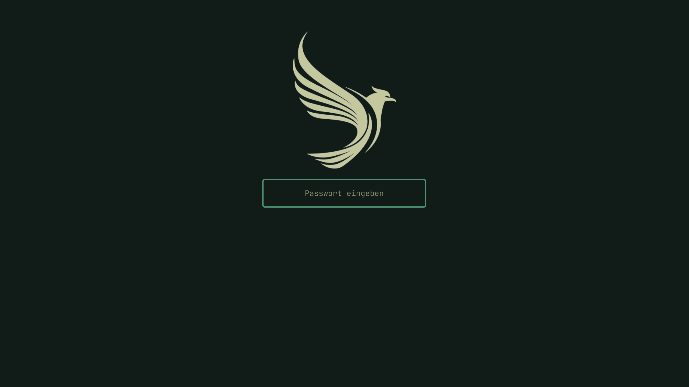

# omarchy-lock-logo

Theme-tinted logo above the [Omarchy](https://omarchy.org) lock screen password field.

Your personal logo sits right above the password input and is automatically
rendered in the **current theme's colors** — switch from Osaka Jade to any other
theme and the logo recolors itself live.



Tested on Omarchy **4.5.0-3** with the default `omarchy-shell` (Quickshell) lock screen.

## How it works

1. Clones the built-in `omarchy.lock` shell plugin into
   `~/.config/omarchy/plugins/<user>.lock` — your own copy, so Omarchy updates
   never overwrite your customization.
2. Converts your PNG into a **white silhouette with transparency**
   (dark motif on a plain light background works best).
3. Renders it on the lock screen through a QML `MultiEffect` with
   `colorization` bound to `Commons.Color.lock.text` — that is where the
   theme colors come from.

## Requirements

- Omarchy with the default shell lock screen (Quickshell)
- ImageMagick 7 (`sudo pacman -S imagemagick`)
- A logo PNG

## Quick install

```bash
git clone https://github.com/<you>/omarchy-lock-logo.git
cd omarchy-lock-logo
./install.sh ~/Pictures/your-logo.png
```

The script is idempotent — safe to run again (e.g. after changing your logo).

## Manual install

<details>
<summary>Step by step, if you prefer doing it by hand</summary>

```bash
# 1. Clone the built-in lock plugin into your own config
omarchy plugin clone omarchy.lock

# 2. Generate a white silhouette with transparency from your PNG
magick your-logo.png -colorspace gray -negate -level 12%,88% mask.png
magick mask.png -fill white -colorize 100 white.png
magick white.png mask.png -alpha off -compose CopyOpacity -composite \
  -trim +repage -resize 900x900 \
  ~/.config/omarchy/plugins/<user>.lock/assets/logo-tint.png

# 3. Insert snippet/lock-logo-block.qml into LockView.qml, right above the
#    fingerprint-notice Text (anchor comment: "The crossed-out icon ...")

# 4. Restart the shell
omarchy restart shell
```

</details>

## Make the mask from your own logo

```bash
./scripts/generate-logo-mask.sh ~/Pictures/your-logo.png output.png
```

The result is a white shape with soft alpha edges — the color comes entirely
from the theme at render time.

## Customize

Edit `~/.config/omarchy/plugins/<user>.lock/LockView.qml` — plugin files hot-reload:

| What            | Where                                        |
|-----------------|----------------------------------------------|
| Logo size       | `sourceSize.width: 240` in the logo `Image`  |
| Gap to the field| `anchors.bottomMargin: 24` on the logo `Item`|
| Color source    | `colorizationColor` — e.g. `Commons.Color.lock.placeholder` for a subtler look |

## Update behavior

Because everything lives in your user plugin folder, `omarchy update` never
touches it. If a big Omarchy update reworks the lock plugin internals, simply
re-run this install to start fresh from the new built-in version:

```bash
omarchy plugin remove <user>.lock
./install.sh ~/Pictures/your-logo.png
```

## Uninstall

```bash
omarchy plugin remove <user>.lock
omarchy restart shell
```

That instantly restores the stock Omarchy lock screen.

## Troubleshooting

- **Lock screen stopped appearing?** The quickest recovery is
  `omarchy plugin remove <user>.lock && omarchy restart shell`.
  Check `journalctl --user` for QML errors from your plugin folder.
- **Known pitfall:** `Image { mipmapSmoothing: true }` fails on Omarchy's
  Quickshell Qt build ("Cannot assign to non-existent property") and takes the
  whole lock plugin down with it — don't add it.
- **ImageMagick 6?** Replace `magick` with `convert` in the scripts.

## Credits

Shared with the Omarchy community. Thanks to DHH & co. for Omarchy — and for
making the lock screen pluggable in the first place.

## License

[MIT](LICENSE)
